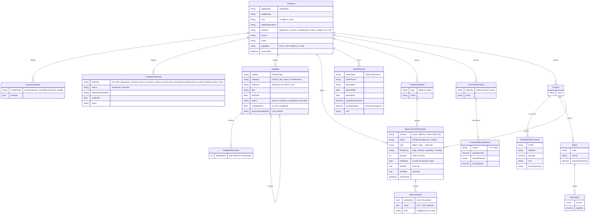

# 03 — Domínio

## Glossário

Nomes em código propostos em inglês — **a confirmar** (ver perguntas em aberto).

| Termo (cliente) | Significado | Nome em código |
|---|---|---|
| Empresa | Indústria atendida | `Company` |
| Módulo | Área regulatória habilitável por empresa | `ModuleType` |
| Licença | Autorização com validade emitida por órgão | `Deadline` (categoria `license`) |
| Prazo / vencimento | Qualquer data que exige ação e alerta | `Deadline` |
| Alerta | Aviso antes do vencimento | `Reminder` |
| Automonitoramento | Medições que a empresa é obrigada a fazer | — (agrupador) |
| Parâmetro | O que se mede periodicamente: ponto de ruído, pH, vazão, insumo… | `MeasurementParameter` |
| Medição / lançamento | Valor de um parâmetro num período, ou "sem medição" com justificativa | `Measurement` |
| Período | Dia, semana ISO, quinzena ou mês de um lançamento | `MeasurementPeriod` |
| Ponto de medição | Local fixo onde se mede ruído | `MeasurementParameter` (contexto `noise`) |
| R.S. — resíduos sólidos | Resíduos classificados por classe | `WasteRecord` (tipo `solid`) |
| R.P. — resíduos perigosos | Resíduos perigosos gerados/armazenados | `WasteRecord` (tipo `hazardous`) |
| ETE | Estação de Tratamento de Efluentes | `TreatmentStation` (tipo `effluent`) |
| ETA | Estação de Tratamento de Água | `TreatmentStation` (tipo `water`) |
| Laudo | Análise técnica com data/resultado (não confundir com relatório exportado) | `Deadline` (datas) / `AnalysisResult` (valores) |
| Produto controlado | Produto químico fiscalizado por PF ou Exército | `ControlledProduct` |
| Órgão | Prefeitura, MAPA, ANVISA, SEMACE, IBAMA, Secretaria de Meio Ambiente, Conselho de Classe, PF, Exército (lista fixa) | `Authority` |
| Registro no órgão | Situação da empresa perante um órgão: possui registro ou precisa obter, com nº e validade | `AuthorityRegistration` |
| Responsável legal | Pessoa que responde legalmente pela empresa | `LegalRepresentative` |
| Razão social / nome fantasia | Nome jurídico / nome comercial | `legalName` / `tradeName` |
| Inscrição estadual | Registro na Sefaz estadual | `stateRegistration` |
| Nota fiscal | Documento fiscal da compra/uso | `invoiceNumber` |
| Lote | Unidade de produção rastreável | `Batch` |
| Matéria-prima | Insumo comprado para produção | `RawMaterialPurchase` |
| Relatório | Arquivo exportado (xlsx/docx) para o órgão | `ExportReport` |

## Decisão de modelagem

Os módulos têm campos diferentes e a cliente disse que "pode incluir mais coisas". Duas abordagens foram consideradas:

1. **Tabelas específicas** por tipo de registro — tipagem forte, relatórios simples, mas cada novo tipo exige migração.
2. **Registros genéricos configuráveis** (tipo de lançamento + campos dinâmicos) — flexível, mas complexo de validar e de exportar.

**Decisão: híbrido começando pelo simples** ([D015](decisoes.md#d015--medições-genéricas-por-período)). Entidades centrais tipadas (empresa, prazo, produto, lote). Para medições, uma estrutura semi-genérica de *parâmetro + valor* (`MeasurementParameter` / `Measurement`), que cobre ruído, ETE/ETA e laudos de análise sem uma tabela para cada caso. Reavaliar após a Fase 2.

## Modelo preliminar

Campos de controle omitidos no diagrama, mas presentes em todas as tabelas: `id` (UUID), `createdAt`, `updatedAt`, `deletedAt`.

### Regras de negócio já identificadas

- **Estoque por lote** = `quantityProduced` − soma de `BatchSale.quantity`. É **calculado**, não digitado.
- **Consolidação anual** de um produto = soma dos lotes produzidos no ano, soma das vendas no ano e soma dos saldos em aberto.
- **Órgãos e módulos** são enums fixos no código, guardados por um código estável em texto ([D007](decisoes.md#d007--órgãos-e-módulos-como-enums-de-domínio)). Órgão sem registro na empresa = "não se aplica".
- **Registro vencido** (`validUntil` anterior a hoje) é derivado, não persistido.
- **Lembretes de prazo** ([D011](decisoes.md#d011--lembretes-de-prazo-em-tabela-filha)): cada prazo tem uma lista de dias antes do vencimento (`DeadlineReminder`), editável. O maior valor é a antecedência do alerta. Padrões: licença `150, 30, 10, 3, 0`; laudo e manutenção `30, 10, 3, 0` (C3).
- **Situação de um prazo** é derivada de `dueDate`, do maior lembrete e do estado, em relação à data atual. Em aberto: *vigente* → *a vencer* (do primeiro alerta até o dia do vencimento, inclusive) → *vencido* (a partir do dia seguinte). Fechado: *renovado*, *concluído* ou *cancelado*.
- **Renovar** cria um novo `Deadline` com a nova data, apontando para o anterior, e marca o anterior como `renewed`. A nova data é posterior à anterior (C20). Excluir o ciclo em aberto desfaz a renovação: o anterior volta a `active` (C20).
- **Concluir** vale para laudo e manutenção (RF-AMB-06): estado `completed` com `completedOn`. Concluído e cancelado podem ser reabertos.
- **Próximos vencimentos** (RF-PRZ-05): prazos em aberto de empresas não arquivadas, com o módulo habilitado (C20).
- **Medições** (task 013, [D015](decisoes.md#d015--medições-genéricas-por-período)): um parâmetro pertence a uma empresa e a um contexto (`noise`, `effluent`, `water`), com frequência própria. O período é identificado pela data de início: o próprio dia (diária), a segunda-feira da semana ISO (semanal), o dia 1 ou 16 (quinzenal, suposição C8) ou o dia 1 (mensal). Uma medição viva por parâmetro e período. Sem valor, a justificativa é obrigatória ("sem medição no período", C26). Período futuro não aceita lançamento; passado e atual podem ser lançados, editados ou apagados. Limites mínimo e máximo opcionais, estritos (igual ao limite está dentro). Mudar a frequência de um parâmetro com medições é recusado.
- **Pendências de lançamento** (C26) são **calculadas**: para cada empresa, contexto e frequência, do período de início do parâmetro até o período atual, um período é pendente se algum parâmetro não arquivado que já cobrava não tem medição (valor ou justificativa). O período atual é "A lançar"; os anteriores, "Atrasado". Parâmetro arquivado não cobra (nem o passado); empresa arquivada, excluída ou com o módulo desligado não aparece. Excluir a empresa exclui logicamente os parâmetros e as medições.
- **Ainda não modelado:** estações (várias ETE/ETA por empresa, task 017) e resíduos (task 016). `TreatmentStation` e `WasteRecord` no diagrama são propostas.
- **Produtos controlados:** o estoque ao fim do mês é informado pela cliente, não calculado. **(?)** confirmar se deveria ser calculado a partir do estoque anterior e das entradas/saídas.
